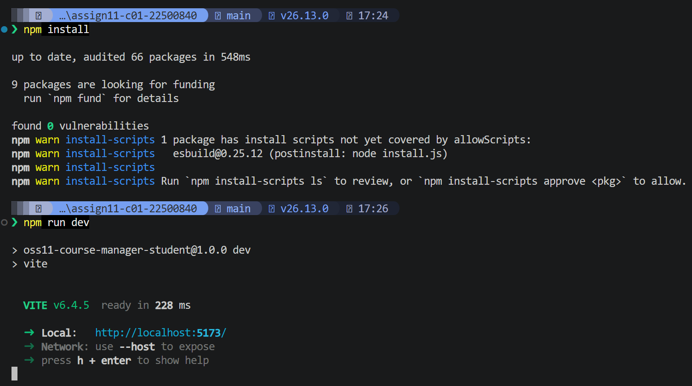
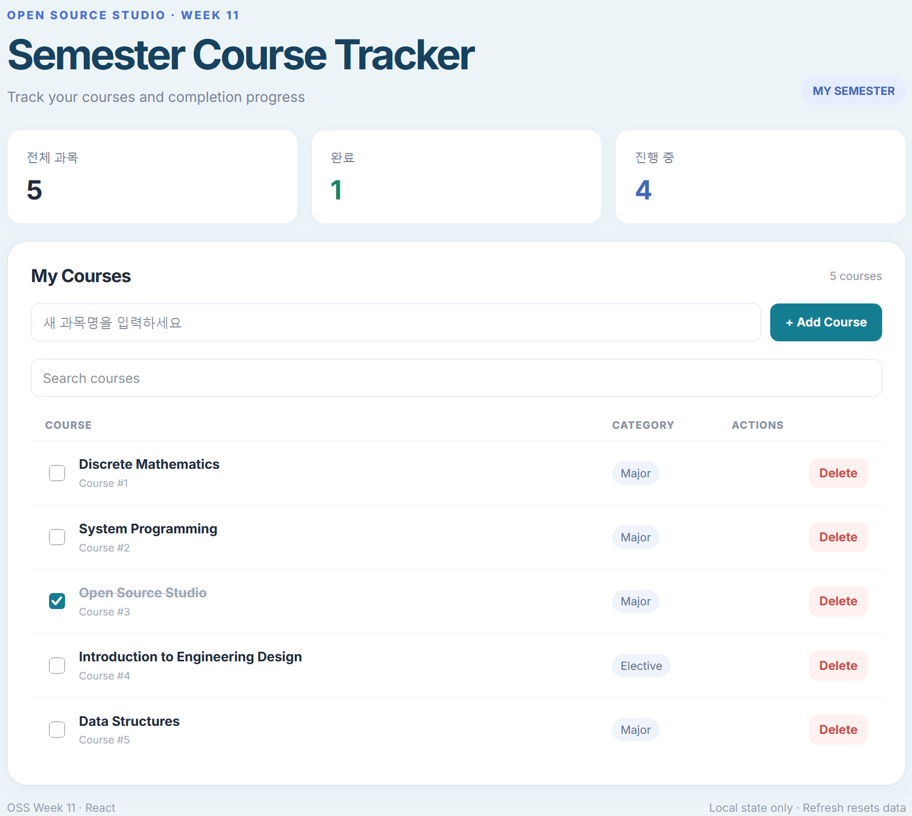

# Semester Course Tracker

## 1. Project Information

- **Project description:** Semester Course Tracker is a React + Vite web application based on the OSS Week 11 sample project. It helps students manage their courses and track completion progress. Course data is stored in React state, so changes are reset when the page is refreshed.
- **Main features:** View courses and completion statistics, add courses, delete courses with confirmation, toggle course completion, and search courses by name.
- **Original sample project:** https://github.com/2026-2-OSS/week11_sample_project

## 2. Installation

Install Node.js (version 20.19+ or 22.12+ recommended), then run:

```bash
npm install
npm run dev
```

Open the local URL displayed in the terminal. To test the production build, run `npm run build`.

- **Screenshot 1:**  
- **Screenshot 2:** 

## 3. Source Code Exploration

### Three main files

1. `src/App.jsx` — The main component that defines the page layout and renders `CourseList`.
2. `src/components/CourseList.jsx` — Manages course data with `useState` and handles adding, deleting, toggling completion, and searching.
3. `src/components/CourseItem.jsx` — Displays an individual course and receives data and event handlers through props.

### Relationship between CourseList and CourseItem

`CourseList` is the parent component, and `CourseItem` is its child component. The parent passes the `course` object and the `onDelete` and `onToggle` callback functions to each `CourseItem` through props. When the user clicks Delete or changes a checkbox, `CourseItem` calls the corresponding callback with `course.id`. The parent then updates its state.

### How useState and the Delete event work

`useState` is a React Hook that stores component state. When `setCourses()` updates the course array, React re-renders the component to reflect the new data.

The delete handler provided in the starter project is:

```jsx
function handleDelete(id) {
  if (!window.confirm('이 과목을 삭제하시겠습니까?')) return;
  setCourses(previous => previous.filter(course => course.id !== id));
}
```

1. The user clicks Delete in `CourseItem`.
2. `onDelete(course.id)` calls `handleDelete(id)` in `CourseList`.
3. `window.confirm()` asks the user to confirm the deletion.
4. `filter()` creates a new array without the selected course, and `setCourses()` updates the state and displayed list.

## 4. Customizing

### Initial course data

I replaced the sample data in `src/data/courses.js` with five courses:

```jsx
export const initialCourses = [
  { id: 1, name: 'Discrete Mathematics', category: 'Major', completed: false },
  { id: 2, name: 'System Programming', category: 'Major', completed: false },
  { id: 3, name: 'Open Source Studio', category: 'Major', completed: true },
  { id: 4, name: 'Introduction to Engineering Design', category: 'Elective', completed: false },
  { id: 5, name: 'Data Structures', category: 'Major', completed: false },
];
```

### Title and description

- **Page title:** Changed from `OSS Course Manager` to `Semester Course Tracker` in `index.html`.
- **Main heading:** Changed from `My Course Manager` to `Semester Course Tracker`.
- **Subtitle:** Changed to `Track your courses and completion progress`.
- **Header tag:** Changed from `STUDENT STARTER` to `MY SEMESTER`.

### CSS changes

I updated `src/App.css` to use a light blue background, darker headings, and teal accent colors.

| Selector / property | Before | After |
| --- | --- | --- |
| `:root` background | `#f5f7fb` | `#edf4f8` |
| `.hero h1` color | No explicit color | `#16425f` |
| `.panel` border color | `#e6ebf1` | `#cbdde8` |
| `.panel` border radius | `18px` | `22px` |
| `.btn.primary` background | `#496fd3` | `#157d91` |
| `.btn.primary:hover` background | `#365bb7` | `#116777` |
| `.check` accent color | `#4c75d1` | `#157d91` |

**Modified files:** `src/data/courses.js`, `index.html`, `src/App.jsx`, `src/App.css`, and `src/components/CourseList.jsx`.

## 5. Feature Extension

### Course Registration

I implemented `handleAdd()` in `CourseList.jsx`:

```jsx
function handleAdd(event) {
  event.preventDefault();

  const name = newName.trim();
  if (name === '') return;

  const newCourse = {
    id: Date.now(),
    name: name,
    category: 'Major',
    completed: false
  };

  setCourses(previous => [...previous, newCourse]);
  setNewName('');
}
```

This function prevents the form's default submission, ignores empty course names, creates a course object, adds it to the state array, and clears the input. New courses appear in the list and increase the total course count.

### Course Completion

I implemented `handleToggle()` to update the selected course:

```jsx
function handleToggle(id) {
  setCourses(previous => previous.map(course =>
    course.id === id
      ? { ...course, completed: !course.completed }
      : course
  ));
}
```

`map()` creates an updated array, and the spread operator (`...`) preserves the other properties of each course. Clicking a checkbox toggles the course's `completed` value, updates its appearance, and changes the completed/in-progress statistics.

### Course Search (Optional)

I added a search input and filtered the displayed courses using:

```jsx
const [search, setSearch] = useState('');
const visibleCourses = courses.filter(course =>
  course.name.toLowerCase().includes(search.trim().toLowerCase())
);
```

The search is case-insensitive and updates the visible list as the user types. It only filters the displayed courses; the original course array and overall statistics remain unchanged.

## 6. Deployment

- **GitHub repository:** https://github.com/Pha1ae/week11_sample_project
- **Vercel URL:** https://week11-sample-project-sepia-delta.vercel.app/

## 7. Weekly Review

1. **Three things I learned:** I learned how `useState` manages component state, how props and callback functions connect parent and child components, and how `map()` and `filter()` can update or display course data without directly modifying the original array.

2. **Challenges and solutions:** Understanding how actions in `CourseItem` change data stored in `CourseList` required extra review. I examined how callbacks pass the course ID to the parent and how `setCourses()` triggers a re-render. I also reviewed how the add, completion, and search handlers work.

3. **AI usage and reflection:** I used AI to help explain React concepts such as `useState`, props, and callbacks. AI explanations were helpful for reviewing the component relationships and documenting the work.